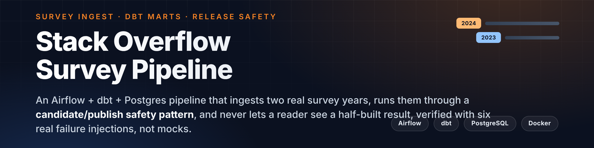
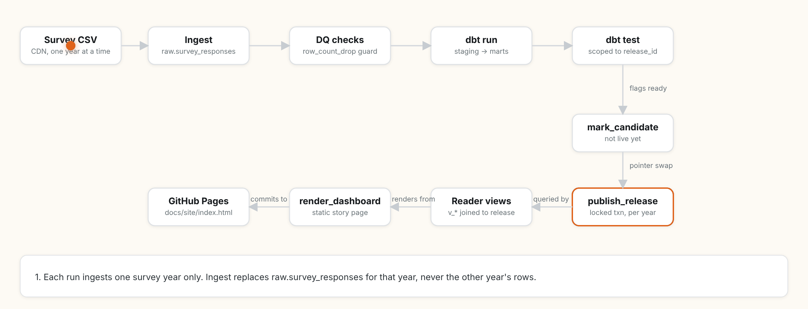

<div align="center">



<br>

[](https://github.com/swagatskalita092/Stack_Overflow_Pipeline/actions/workflows/ci.yml)

[](https://doi.org/10.5281/zenodo.24428050)


[Live dashboard](https://swagatskalita092.github.io/Stack_Overflow_Pipeline/site/) &nbsp;|&nbsp; [Project summary report](PROJECT_SUMMARY_REPORT.md) &nbsp;|&nbsp; [Engineering journal](docs/engineering_journal.md) &nbsp;|&nbsp; [Failure modes](docs/failure_modes.md)

<br>



</div>

<br>

An end-to-end data engineering pipeline that ingests the Stack Overflow
Developer Survey (**2023 and 2024**), runs it through structured data quality
checks, transforms it through a layered dbt model architecture, and publishes
three analytical marts covering **salary benchmarks**, **technology
adoption**, and **AI sentiment**. Every publish goes through a
candidate/publish safety pattern so readers never see a half-built or
rolled-back result, and a static dashboard is regenerated from the published
views after each run.

This isn't just a pipeline that moves data from A to B. The engineering
effort went into three things most portfolio pipelines skip: six real
failure injections against a live stack, recorded in
[docs/failure_modes.md](docs/failure_modes.md) (injection 1 published junk
and was later guarded by `row_count_drop`; injection 5 was inconclusive);
proving the pipeline survives its data source actually changing shape (a
second real survey year, with genuine schema drift handled and tested, not
simulated); and catching a real correctness bug that had been silently
wrong since the first version (found by a dashboard forcing a look at real
per-cell coverage, not by a passing test suite). See
[`PROJECT_SUMMARY_REPORT.md`](PROJECT_SUMMARY_REPORT.md) for the full
account.

## &nbsp; Start here

| Read | You will find |
| --- | --- |
| [Architecture](#architecture) | The full build-then-publish path, as a diagram |
| [Engineering rigor](#engineering-rigor-beyond-the-happy-path) | Publication safety, real failure injection, schema drift, reproducible numbers |
| [Quick start](#quick-start) | `docker compose up`, the Airflow UI, and the DAG task order |
| [Data model](#data-model-dbt) | Staging, intermediate, and the three marts, grain and all |
| [Dashboard](#dashboard-static-not-live) | How the static story page gets built and published |
| [More detail](#more-detail) | The full write-up and the investigation-by-investigation journal |

## &nbsp; Architecture


Every row carries a `release_id` and `survey_year`. `dwh.active_release` is
tracked **per year**, so a candidate's sequence number is only ever compared
against its own year's active release; 2023 and 2024 publish independently
and can never move each other's pointer. Readers query
`marts.v_salary_analytics`, `marts.v_tech_adoption`, and
`marts.v_ai_sentiment`, joined to that per-year active release, never
`marts.mart_*` directly, since that table can hold an unpublished candidate.

**Stack:** Apache Airflow 2.8 (orchestration), PostgreSQL 16 (warehouse), dbt
(transformations), Python (ingest + DQ), Docker Compose (runtime)

### Engineering rigor, beyond the happy path

| Area | What's actually there | Where |
| --- | --- | --- |
| Publication safety | Release/candidate/publish pattern, per-year monotonicity guard under a Postgres advisory lock, proven with regression tests (identical rerun, failed test, crash-and-retry, overlapping publishes, cross-year isolation) | `scripts/release.py`, `tests/test_publication_safety.py`, `tests/test_year_2023.py` |
| Required CI | Real `postgres:16` service container, real `dbt run`/`dbt test` against hand-calculated fixtures, lint, DAG-structure check. Required on every PR, zero CDN dependency | `.github/workflows/ci.yml` |
| Real failure injection | Six real failures triggered against a live, fully-running Docker Compose stack (container kills mid-transaction, overlapping DAG runs, a downstream test failure), not simulated, with an honest table of what held and what didn't | `docs/failure_modes.md` |
| Schema-drift handling | A second real survey year (2023) with a genuinely different schema, a documented per-year data contract, and NULL-not-zero handling for questions that weren't asked that year | `docs/data_contracts.md`, `tests/test_year_2023.py` |
| Reproducible measurement | Real baseline runtimes against the actual ~65k-row 2024 dataset, 5 repeated runs, machine specs recorded, ranges not cherry-picked | `docs/reproducibility.md` |
| Known limitations, stated plainly | What CI doesn't cover, what raw-layer safety doesn't guarantee, on purpose, not a backlog dressed up as documentation | `docs/known_limitations.md` |
| Engineering journal | Every real investigation across every phase, in question, hypothesis, experiment, result, decision, regression test, remaining limitation format, including the most significant bug in the project (`avg_job_satisfaction` silently NULL since Phase A) | `docs/engineering_journal.md` |

## &nbsp; Prerequisites

- [Docker](https://docs.docker.com/get-docker/) and [Docker Compose](https://docs.docker.com/compose/install/)
- On Linux/Mac, optional: set `AIRFLOW_UID` (e.g. `export AIRFLOW_UID=$(id -u)`) so Airflow can write logs

## &nbsp; Quick Start

1. **Start Postgres and Airflow (first time: init DB + create admin user)**

   ```bash
   cd stackoverflow-pipeline
   docker compose up -d postgres
   docker compose run --rm airflow-init
   docker compose up -d airflow-webserver airflow-scheduler
   ```

2. **Open Airflow UI**

   - URL: http://localhost:8080
   - Login: `admin` / `admin`

3. **Run the pipeline**

   - Unpause the DAG **`stackoverflow_survey_pipeline`** (toggle on the left).
   - Trigger a run manually or wait for the weekly schedule.
   - Order of tasks: `open_release`, `ingest_raw_survey`, `record_source_checksum`, `run_dq_checks`, `dbt_seed`, `dbt_run_models`, `dbt_test_models`, `mark_candidate`, `publish_release`, `render_dashboard`.

4. **Query the results**

   - Connect to Postgres (host `localhost`, port `5432`, user `airflow`, password `airflow`).
   - Database `survey_db` contains schemas `raw`, `staging`, `intermediate`, `marts`, and `dwh`.

## &nbsp; Project Structure

```
stackoverflow-pipeline/
├── airflow/
│   └── dags/
│       └── stackoverflow_pipeline_dag.py   # open_release, ingest_raw_survey, record_source_checksum, run_dq_checks, dbt_seed, dbt_run_models, dbt_test_models, mark_candidate, publish_release, render_dashboard
├── scripts/
│   ├── init_db.sql                        # Creates survey_db, raw + dwh schemas, tables
│   ├── migrate_release_safety.sql         # Release/candidate/publish schema, per-year active_release
│   ├── ingest_survey.py                   # Download, extract, clean, year-scoped load into raw.survey_responses
│   ├── dq_checks.py                       # Data quality checks (year-scoped) to dwh.dq_issues
│   ├── release.py                         # open_release / mark_candidate / publish_release, per-year monotonicity guard
│   ├── render_dashboard.py                # Query marts.v_* to the story page at docs/site/index.html
│   ├── dashboard_templates/               # Jinja2 for the static dashboard
│   └── chaos/                             # Reusable failure-injection scripts (Phase D), run by hand
├── docs/
│   ├── site/                              # GitHub Pages dashboard (served at /site/)
│   ├── data_contracts.md                  # Mart semantics, per-year column coverage
│   ├── data_quality_policy.md
│   ├── failure_modes.md                   # Six real failure injections against a live stack
│   ├── reproducibility.md                 # Real baseline runtimes, machine specs
│   └── known_limitations.md               # Stated gaps, on purpose
├── dbt_project/
│   ├── dbt_project.yml
│   ├── models/
│   │   ├── staging/                       # stg_survey_responses, grain (survey_year, response_id)
│   │   ├── intermediate/                  # int_languages_exploded, int_databases_exploded
│   │   └── marts/                         # mart_salary_analytics, mart_tech_adoption, mart_ai_sentiment
│   └── ...
├── tests/                                 # Publication safety, mart correctness, schema-drift, dashboard tests
├── .github/workflows/
│   ├── ci.yml                             # Required on every PR: fixtures only, no CDN
│   └── real-dataset-check.yml             # Weekly + manual: real CDN end to end, non-required
├── docker-compose.yml
├── README.md
└── PROJECT_SUMMARY_REPORT.md              # Full write-up: what, why, how, and what was actually found
```

## &nbsp; Pipeline Tasks

| Task | Description |
| --- | --- |
| **open_release** | Inserts `dwh.pipeline_releases` (`building`, with `survey_year`) and pushes `release_id` to XCom. |
| **ingest_raw_survey** | Downloads that year's survey CSV, cleans it, replaces `raw.survey_responses` **for that year only**. |
| **record_source_checksum** | Hashes that year's raw rows; flags identical-to-published source for the same year (still builds). |
| **run_dq_checks** | Checks scoped to `survey_year`, written to `dwh.dq_issues`. Blocking checks fail the DAG (see `docs/data_quality_policy.md`). |
| **dbt_seed** | Runs `dbt seed` with this run's `release_id` and `survey_year` so seed tables are loaded before `dbt run`. |
| **dbt_run_models** | Staging, intermediate, then append mart rows tagged with `release_id` and `survey_year`. |
| **dbt_test_models** | dbt tests, scoped to this `release_id` for mart not_null checks. |
| **mark_candidate** | `candidate_ready` or `candidate_ready_unchanged_source`. Does **not** move the live pointer. |
| **publish_release** | One locked transaction, scoped to this year: this year's `dwh.active_release` row becomes this candidate. |
| **render_dashboard** | After publish: write `docs/site/index.html` from `marts.v_*`. Failure fails this task only; it does not unpublish. |

Readers query `marts.v_salary_analytics`, `marts.v_tech_adoption`, `marts.v_ai_sentiment` (join to the per-year active release). Do not query `marts.mart_*` for official numbers.

Trigger a 2023 run with DAG conf `{"survey_year": 2023}` or env `SURVEY_YEAR=2023`. Default is 2024.

## &nbsp; Dashboard (static, not live)

After `publish_release`, `render_dashboard` writes [docs/site/index.html](docs/site/index.html) from `marts.v_*`. The page is a plain-language story of the published years: languages, databases, pay, job satisfaction, and how the pipeline works. Bars are inline CSS: no client-side JS, no external CDN, every number is readable in the generated HTML. The snapshot date is the latest `published_at`. If a question was not asked in a published year, the story says so. It does not draw a 0% bar for a missing question. Year-over-year sections appear only when two or more years are published.

Public URL: **https://swagatskalita092.github.io/Stack_Overflow_Pipeline/site/**

GitHub Pages serves the `/docs` folder on `main`, not `/docs/site` as a source. That is why the dashboard lives at `/site/` on the Pages host, and [docs/index.html](docs/index.html) is a one-click redirect there.

A new pipeline run updates the file on disk (Compose mounts `./docs`). GitHub Pages only changes when that file is committed and pushed to `main`.

The committed snapshot is dated 2026-09-18, before historical ECB conversion was added (PR #8). Running and publishing the pipeline again regenerates the story page from the live published marts.

## &nbsp; Data Model (dbt)

- **Staging:** `stg_survey_responses`, one row per `(survey_year, response_id)`; numeric casting for `years_code`, `years_code_pro`, `comp_total_raw` (local currency as entered) plus `comp_total_usd_converted` from historical ECB rates in `fx_rates_to_usd.csv`; unmapped currencies stay NULL.
- **Intermediate:** `int_languages_exploded`, `int_databases_exploded`: one row per (response, language) or (response, database); includes `wants_to_continue` from "want to work with" fields.
- **Marts:**
  - **mart_salary_analytics**: append-only per `(release_id, survey_year)`. Official read is `marts.v_salary_analytics`. Aggregations by country, experience band, dev type, remote work, org size; filters e.g. 10k to 5M, at least 5 respondents.
  - **mart_tech_adoption**: languages and databases: total users, want-to-continue count, retention %; usage rank by tech type; filters e.g. at least 100 users.
  - **mart_ai_sentiment**: by country and dev type: AI tool usage/sentiment; respondent count, optional job satisfaction and % seeing AI as threat; minimum 3 respondents. `avg_job_satisfaction` and `pct_see_ai_as_threat` are explicitly NULL (not `0.0`) when a cell has no answers to average, see `docs/data_contracts.md`.

## &nbsp; Data Source

- **Survey:** [Stack Overflow Developer Survey 2024](https://survey.stackoverflow.co/2024/) and [2023](https://survey.stackoverflow.co/2023/)
- **2024 dataset:** public extract (114 columns, 65,437 real rows confirmed via live ingest). **2023 dataset:** public extract (84 columns, 89,184 real rows confirmed via live ingest). `AIThreat`/`JobSat` are genuinely absent from the 2023 schema, confirmed by comparing the two real headers directly; the marts store NULL for those years, never a fabricated `0.0`.

## &nbsp; Environment Variables (optional)

For ingest and DQ scripts (defaults work with Docker Compose):

| Variable             | Default    | Description        |
|----------------------|------------|--------------------|
| `SURVEY_DB_HOST`     | `postgres` | PostgreSQL host    |
| `SURVEY_DB_PORT`     | `5432`     | PostgreSQL port   |
| `SURVEY_DB_NAME`     | `survey_db`| Database name      |
| `SURVEY_DB_USER`     | `airflow`  | Database user      |
| `SURVEY_DB_PASSWORD` | `airflow`  | Database password  |
| `SURVEY_YEAR`        | `2024`     | Which survey year `ingest_raw_survey`/`publish_release` operate on |

## &nbsp; More Detail

For the full write-up, why this was built, the approach, the dataset, the data quality checks, and an honest account of every real bug found and fixed along the way, see **[PROJECT_SUMMARY_REPORT.md](PROJECT_SUMMARY_REPORT.md)**. For the investigation-by-investigation detail behind those bugs, question, hypothesis, experiment, result, decision, regression test, remaining limitation, see **[docs/engineering_journal.md](docs/engineering_journal.md)**.

## &nbsp; License

MIT. See [LICENSE](LICENSE).

## &nbsp; Author

Swagat Subhash Kalita built and runs this pipeline.

[GitHub](https://github.com/swagatskalita092) &nbsp;|&nbsp; [LinkedIn](https://linkedin.com/in/swagat-s-kalita)
